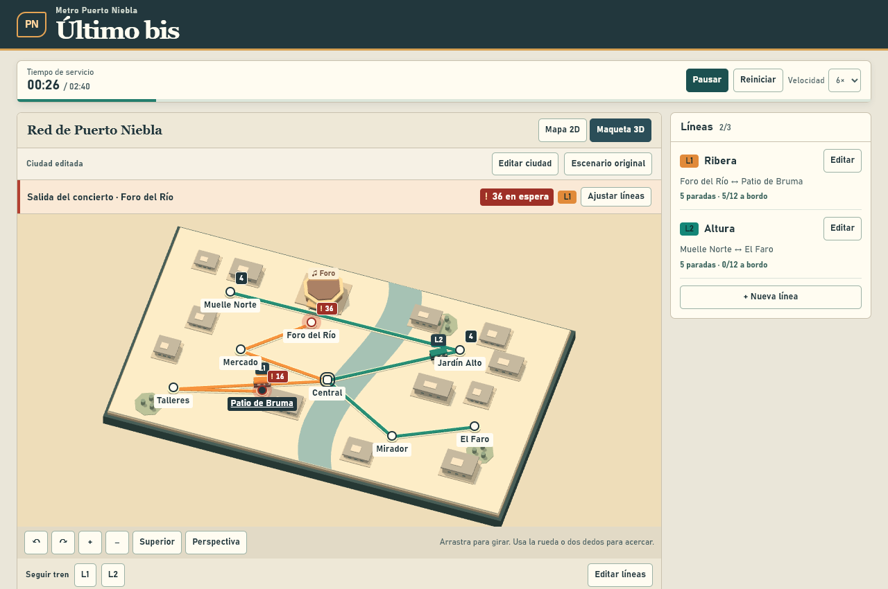

# Último bis · Metro Puerto Niebla

[Abre la demo en GitHub Pages](https://humiumii.github.io/puzle-metro/)

Se apagan las luces del Foro del Río y el público sale de golpe. Tienes 2:40 de servicio para llevar a la mayor cantidad de personas a sus destinos. La ciudad y su red de ocho estaciones son ficticias.



## Cómo jugar

1. Pulsa **Iniciar partida**. El concierto termina en el segundo 18 y la demanda sube en el Foro del Río.
2. Selecciona una estación para ver las líneas que la sirven y su cola por destino. Las etiquetas con **!** marcan estaciones con 12 personas o más en espera.
3. Abre **Gestionar líneas** en móvil. Pulsa **Editar** o **Nueva línea** y selecciona estaciones en orden. Pulsa una parada marcada para quitarla o **Vaciar recorrido** para redibujar la línea. El trazado punteado muestra el borrador hasta que pulses **Aplicar ruta**.
4. Puedes pausar, reanudar o cambiar la velocidad. Al cerrar el servicio verás cuántas personas llegaron, cuántas siguieron en estación o a bordo y cuánto esperaron, en promedio, quienes sí llegaron.
5. **Reiniciar** recupera la red inicial y repite las mismas llegadas. El siguiente resumen muestra también los resultados de la última partida completa.

Para reproducir la comparación, juega primero con la red inicial. En otra partida, pausa en 00:38, edita L2 y agrega Foro del Río después de El Faro. Al aplicar la ruta y reanudar, el Foro tendrá un servicio directo a El Faro y Mirador.

| Estrategia | Llegaron | Esperan | A bordo | Espera media |
| --- | ---: | ---: | ---: | ---: |
| Red inicial | 23 | 63 | 9 | 49,3 s |
| L2 extendida al Foro en 00:38 | 43 | 48 | 4 | 47,2 s |

## Maqueta y editor de ciudad

- Cambia entre **Mapa 2D** y **Maqueta 3D** en cualquier momento. En 3D, arrastra para girar, usa la rueda o el gesto de dos dedos para acercar y pulsa **Superior** para ver la ciudad desde arriba. **Seguir tren** muestra la ocupación y la próxima parada de una línea y centra la cámara en 3D.
- Abre **Editar ciudad** para crear una copia del escenario. Pulsa **Nueva estación**, toca el suelo de la maqueta o un punto del mapa y revisa el marcador de posición. Escribe el nombre y pulsa **Confirmar ubicación**. Puedes renombrar, mover o borrar la estación desde su ficha.
- Abre **Editar líneas**, elige una línea y agrega la nueva parada desde el mapa o la maqueta. La propuesta numerada aparece antes de pulsar **Aplicar ruta**.
- En la ficha, configura **Sentido**, **Otra estación** y **Pasajeros**, y pulsa **Asignar demanda**. La demanda editada entra en el segundo 24. Una estación sin conexión puede acumular personas esperando. Para retirar una asignación del mismo par y sentido, guarda una cantidad de cero.
- **Guardar ciudad** conserva estaciones, líneas y demanda en un espacio de guardado del navegador. La ciudad guardada se abre al recargar y **Jugar ciudad** inicia una simulación nueva. **Escenario original** vuelve al concierto base. **Abrir ciudad guardada** restaura la copia conservada.
- Al borrar una estación se quita de cada recorrido y se unen sus paradas vecinas. Se elimina cualquier línea que quede con menos de dos paradas y la demanda que use la estación borrada como origen o destino.

[Clip de la estación Patio de Bruma en servicio](docs/diseno/ciudad/estacion-en-servicio.mp4)

## Motor

`src/engine.ts` es independiente de React. Cada paso avanza un segundo simulado. El motor incorpora llegadas programadas, mueve un tren de 12 plazas por línea en ambos sentidos y procesa los descensos antes de los ascensos. La duración de cada tramo depende de su distancia en el mapa.

Cada persona tiene un destino. El motor busca un viaje directo o un itinerario con un transbordo. Si la red no ofrece un itinerario, el tren va en la dirección opuesta o no quedan plazas, la persona espera. La espera media suma los segundos en cola de quienes llegaron, incluidas las esperas de transbordo.

Al editar una línea activa, el tren termina el tramo en curso o se queda en el andén si ya estaba detenido. Quienes llegaron a su destino completan el viaje y el resto pasa a la cola de ese andén conservando su espera y destino. El tren inicia el recorrido actualizado desde ese andén si sigue incluido, o se recoloca vacío en la primera parada nueva.

## Desarrollo local

Con Node.js 24 y npm:

```sh
npm ci
npm run dev
npm test
npm run build
npm run preview
```

Las pruebas cubren viajes con transbordo, desborde de capacidad, destinos sin conexión, conservación de pasajeros al editar una línea en movimiento, validación del guardado y simulación con estaciones nuevas. El workflow de GitHub Actions ejecuta las pruebas y publica el directorio `dist/` desde `main`.
